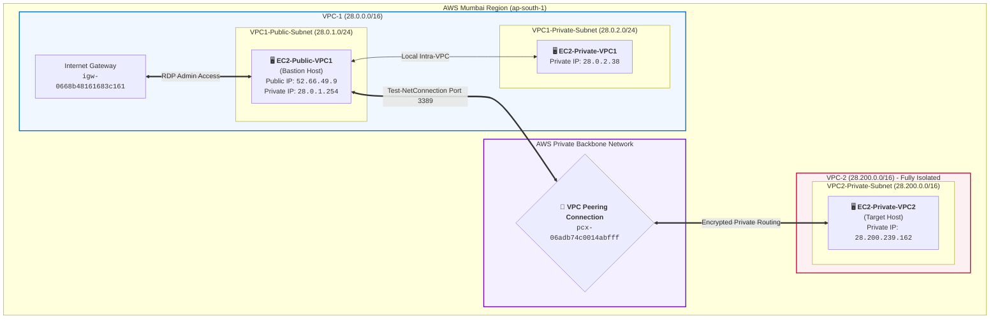

<div align="center">

# 🌐 AWS Inter-VPC Peering Architecture & Verification

[](https://aws.amazon.com/)
[](https://www.microsoft.com/windows-server)
[](https://microsoft.com/powershell)
[](#-end-to-end-verification--evaluation-proof)

**End-to-End Cross-VPC Communication using AWS Peering Link, Route Tables, and Windows Bastion Host**

---

</div>

## 📖 Executive Summary

This project showcases the architecture, deployment, and validation of an **Inter-VPC Peering Connection** in the AWS Mumbai Region (`ap-south-1`). By connecting two architecturally isolated Virtual Private Clouds (**VPC-1** and **VPC-2**), internal workloads securely communicate using private IPv4 addressing without routing traffic over the public internet.

The network is validated using a **Windows Server Bastion Host** in VPC-1 to test TCP reachability against an isolated private server inside VPC-2.

---

## 🏛️ Network Architecture & Topology



---

## 📋 Infrastructure & IP Addressing Scheme

| Resource / Parameter | VPC-1 (Requester) | VPC-2 (Accepter) | Description |
| :--- | :--- | :--- | :--- |
| **VPC CIDR Block** | `28.0.0.0/16` | `28.200.0.0/16` | Non-overlapping IPv4 address space |
| **Public Subnet** | `28.0.1.0/24` | *None* | Hosts the public-facing Bastion host |
| **Private Subnet** | `28.0.2.0/24` | `28.200.0.0/16` | Fully isolated internal subnets |
| **Internet Gateway** | `igw-0668b48161683c161` | *None* | Attached to VPC-1 for administrative access |
| **Peering Connection** | `pcx-06adb74c0014abfff` | `pcx-06adb74c0014abfff` | Bidirectional AWS VPC peering tunnel |
| **Target Test Instance** | `EC2-Public-VPC1` | `EC2-Private-VPC2` | Verified via RDP TCP Port 3389 |

---

## 🛠️ Step-by-Step Implementation

### 1. VPC & Subnet Provisioning
* Created **`VPC-1`** (`28.0.0.0/16`) and **`VPC-2`** (`28.200.0.0/16`).
* Configured dedicated public and private subnets across Availability Zone `ap-south-1a`.
* Attached an Internet Gateway (`VPC1-IGW`) to VPC-1.

### 2. VPC Peering Tunnel Establishment
* Initiated a peering request from `VPC-1` targeting `VPC-2`.
* Accepted the peering request (`pcx-06adb74c0014abfff`) to set the link status to **Active**.

### 3. Route Table Configurations
* **`VPC1-Public-RT`**:
  * `0.0.0.0/0` $
ightarrow$ `igw-0668b48161683c161` (Internet egress)
  * `28.0.0.0/16` $
ightarrow$ `local`
  * `28.200.0.0/16` $
ightarrow$ `pcx-06adb74c0014abfff` (Cross-VPC Peering)
* **`VPC2-Private-RT`**:
  * `28.200.0.0/16` $
ightarrow$ `local`
  * `28.0.0.0/16` $
ightarrow$ `pcx-06adb74c0014abfff` (Reverse Peering route)

### 4. Firewall & Security Group Rules
* Configured **`peering-sg-vpc1`** and **`peering-sg-vpc2`**:
  * **Inbound:** Allow **RDP (TCP Port 3389)** and **ICMP (IPv4)** from anywhere (`0.0.0.0/0`) / VPC CIDRs for management and automated network probing.
  * **Outbound:** All traffic allowed (`0.0.0.0/0`).

---

## 🔍 End-to-End Verification & Evaluation Proof

Logged into the **Bastion Host** (`EC2-Public-VPC1` at `28.0.1.254`) via Remote Desktop and verified cross-network reachability to `EC2-Private-VPC2` (`28.200.239.162`) using PowerShell.

```powershell
Test-NetConnection -ComputerName 28.200.239.162 -Port 3389
```

### 💻 Execution Output

```text
ComputerName           : 28.200.239.162
RemoteAddress          : 28.200.239.162
RemotePort             : 3389
InterfaceAlias         : Ethernet
SourceAddress          : 28.0.1.254
TcpTestSucceeded       : True
```

---

## 📸 Project Artifacts & Screenshots

### 1. Final Peering Verification (`TcpTestSucceeded : True`)
> **Demonstrates successful private packet routing between VPC-1 and VPC-2 via the peering link.**

<p align="center">
  
</p>

---

### 2. VPC-1 Route Table Configuration
> **Validates the peering target route entry pointing destination `28.200.0.0/16` to `pcx-06adb74c0014abfff`.**

<p align="center">
  
</p>

---

### 3. Deployed EC2 Instances
> **Shows all three Windows Server instances in active running state across both VPCs.**

<p align="center">
  
</p>

---

## 💡 Key Engineering Takeaways

1. **Non-Overlapping CIDRs**: VPC peering strictly requires non-overlapping IP address ranges (e.g., `28.0.0.0/16` and `28.200.0.0/16`).
2. **Two-Way Symmetric Routing**: Adding the peering connection alone is not sufficient; route tables on **both** VPCs must contain explicit entries directing target traffic to the `pcx` identifier.
3. **Public Bastion Route Requirement**: The public route table (`VPC1-Public-RT`) must also contain the peering route to allow the Bastion host itself to inspect and probe workloads in the peered VPC.
4. **Reliable TCP Probing**: Windows Server instances block ICMP pings by default. Using PowerShell's `Test-NetConnection -Port 3389` confirms TCP socket establishment without modifying guest firewall policies.

---

<div align="center">
  <sub>Architecture Designed & Implemented on AWS Console | Submission Ready</sub>
</div>
