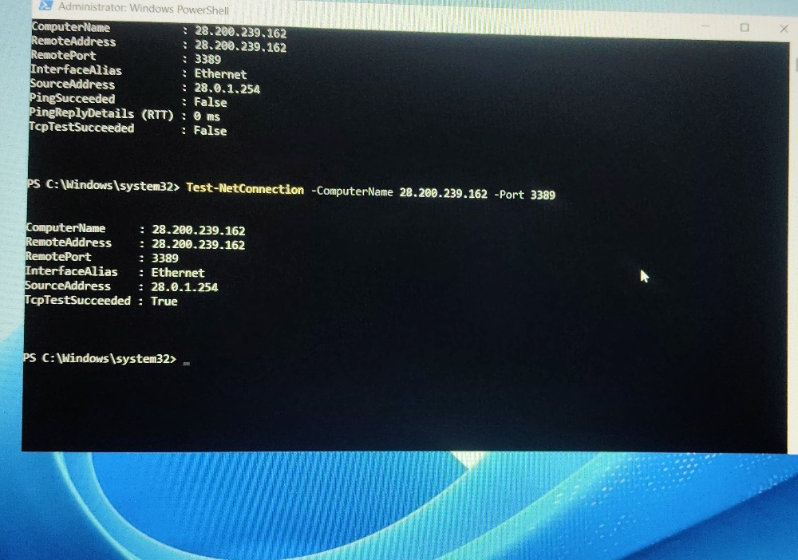
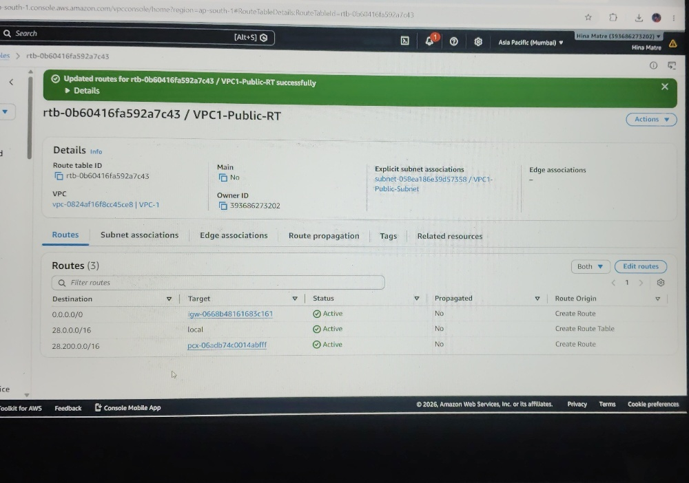
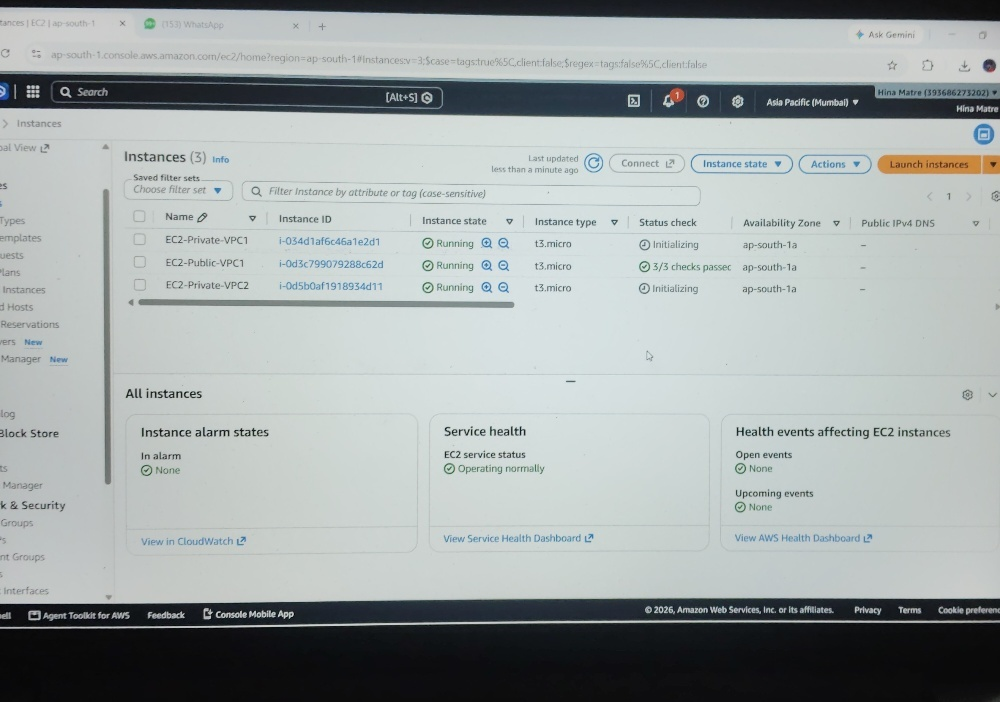

<div align="center">

# 🌐 AWS Inter-VPC Peering Architecture & Verification

[](https://aws.amazon.com/)
[](https://www.microsoft.com/windows-server)
[](https://microsoft.com/powershell)
[](#-end-to-end-verification--evaluation-proof)

**Secure Cross-VPC Private Communication via AWS Peering, Route Tables, and Bastion Host Routing**

---

</div>

## 📖 Executive Summary

This project demonstrates the design, deployment, and end-to-end network validation of an **Inter-VPC Peering Connection** in the AWS Asia Pacific (Mumbai) Region (`ap-south-1`). By interconnecting two non-overlapping Virtual Private Clouds (**VPC-1** and **VPC-2**), isolated workloads achieve private, bidirectional IPv4 communication across the AWS global network backbone without routing traffic over the public internet.

Validation was conducted from a **Windows Server Bastion Host** deployed in the public tier of VPC-1, verifying TCP socket reachability on Port 3389 to an isolated private server inside VPC-2.

---

## 🏗️ Network Architecture & Topology

<p align="center">
  
</p>

### 📌 Architecture & Traffic Flow Breakdown

1. **Client [C] (Admin Laptop):** Establishes an encrypted administrative Remote Desktop Protocol (RDP Port 3389) session over the internet to the Bastion Host.
2. **Internet Gateway (`igw-0668b48161683c161`):** Attached to VPC-1 to enable public ingress/egress for administrative connectivity.
3. **VPC-1 (`28.0.0.0/16`):**
   * **Public Subnet (`28.0.1.0/24`):** Contains the Bastion Host (`EC2-Public-VPC1`) assigned Public IP `52.66.49.9` and Private IP `28.0.1.254`.
   * **Private Subnet (`28.0.2.0/24`):** Contains the internal database/app host (`EC2-Private-VPC1`) assigned Private IP `28.0.2.38`.
   * **Route Tables (`VPC1-Public-RT` & `VPC1-Private-RT`):** Route local traffic internally and forward destination traffic destined for `28.200.0.0/16` to the Peering Connection target.
4. **VPC Peering Connection (`pcx-06adb74c0014abfff`):**
   * Bidirectional network link established between requester `VPC-1` and accepter `VPC-2`.
   * Traffic traverses private AWS fiber without bandwidth bottlenecks, single points of failure, or NAT requirements.
5. **VPC-2 (`28.200.0.0/16` - Fully Isolated):**
   * **Private Subnet (`28.200.0.0/16`):** Contains the target private host (`EC2-Private-VPC2`) assigned Private IP `28.200.239.162`.
   * Completely isolated environment with no Internet Gateway, NAT Gateway, or public IP addresses attached.

---

## 📋 Infrastructure & IP Addressing Scheme

| Resource / Parameter | VPC-1 (Requester) | VPC-2 (Accepter) | Technical Description |
| :--- | :--- | :--- | :--- |
| **VPC CIDR Block** | `28.0.0.0/16` | `28.200.0.0/16` | Strict non-overlapping IPv4 address space |
| **Public Subnet** | `28.0.1.0/24` | *None* | Bastion jump host tier (`256` IPs) |
| **Private Subnet** | `28.0.2.0/24` | `28.200.0.0/16` | Isolated application/workload tiers |
| **Internet Gateway** | `igw-0668b48161683c161` | *None* | Attached to VPC-1 for admin ingress |
| **Peering Connection** | `pcx-06adb74c0014abfff` | `pcx-06adb74c0014abfff` | Active bidirectional peering link |
| **Compute Instances** | `EC2-Public-VPC1`<br>`EC2-Private-VPC1` | `EC2-Private-VPC2` | Windows Server 2025 (`t3.micro`) |

---

## 🛠️ Step-by-Step Implementation

### 1. VPC & Subnet Provisioning
* Provisioned **`VPC-1`** (`28.0.0.0/16`) and **`VPC-2`** (`28.200.0.0/16`) in `ap-south-1a`.
* Created dedicated public (`28.0.1.0/24`) and private (`28.0.2.0/24`) subnets inside VPC-1, alongside a fully private subnet (`28.200.0.0/16`) inside VPC-2.
* Attached Internet Gateway `igw-0668b48161683c161` to `VPC-1`.

### 2. VPC Peering Tunnel Establishment
* Created a peering request from requester VPC (`VPC-1`) targeting accepter VPC (`VPC-2`).
* Accepted the peering request (`pcx-06adb74c0014abfff`), transitioning the link status to **Active**.

### 3. Route Table Routing Rules
Configured symmetric routing rules across all routing tables:

* **`VPC1-Public-RT` (Associated with `VPC1-Public-Subnet`):**
  * `0.0.0.0/0` $\rightarrow$ `igw-0668b48161683c161` (Default route for internet egress)
  * `28.0.0.0/16` $\rightarrow$ `local` (Intra-VPC route)
  * `28.200.0.0/16` $\rightarrow$ `pcx-06adb74c0014abfff` (Cross-VPC Peering route)
* **`VPC2-Private-RT` (Associated with `VPC2-Private-Subnet`):**
  * `28.200.0.0/16` $\rightarrow$ `local`
  * `28.0.0.0/16` $\rightarrow$ `pcx-06adb74c0014abfff` (Reverse Peering route for returning packets)

### 4. Security Group Configurations
* **`peering-sg-vpc1`**: Inbound RDP (Port 3389) and ICMP enabled for administration.
* **`peering-sg-vpc2`**: Inbound RDP (Port 3389) and ICMP enabled from VPC-1 ranges to permit verification traffic.

---

## 🔍 End-to-End Verification & Evaluation Proof

Logged into the **Bastion Host** (`EC2-Public-VPC1` at `28.0.1.254`) via Remote Desktop and executed a network connectivity probe to the target instance in VPC-2 (`EC2-Private-VPC2` at `28.200.239.162`):

```powershell
Test-NetConnection -ComputerName 28.200.239.162 -Port 3389
```

### 💻 Execution Output

```text
ComputerName           : 28.200.239.162
RemoteAddress          : 28.200.239.162
RemotePort             : 3389
InterfaceAlias         : Ethernet
SourceAddress          : 28.0.1.254
TcpTestSucceeded       : True
```

---

## 📸 Project Artifacts & Screenshots

### 1. Final Peering Verification (`TcpTestSucceeded : True`)
> **Confirms active packet routing from VPC-1 (`28.0.1.254`) across the peering link to VPC-2 (`28.200.239.162`).**

<p align="center">
  
</p>

---

### 2. VPC-1 Route Table Configuration
> **Validates the route entry directing destination CIDR `28.200.0.0/16` to target `pcx-06adb74c0014abfff`.**

<p align="center">
  
</p>

---

### 3. Deployed EC2 Instances
> **Displays the three Windows Server instances running across both VPC environments.**

<p align="center">
  
</p>

---

## 💡 Key Engineering Takeaways

1. **Non-Overlapping CIDRs**: VPC Peering requires completely distinct IPv4 blocks (`28.0.0.0/16` vs. `28.200.0.0/16`).
2. **Symmetric Two-Way Routing**: Creating the peering connection is insufficient on its own; both route tables must explicitly route traffic to the `pcx-` ID.
3. **Public Bastion Route Requirement**: The public route table (`VPC1-Public-RT`) must also contain the destination route to the peered CIDR to allow test probes originating from the Bastion host.
4. **Reliable TCP Probing**: Windows Server instances suppress ICMP echo replies by default. Using PowerShell's `Test-NetConnection -Port 3389` confirms TCP 3-way handshake completion reliably.

---

<div align="center">
  <sub>Architecture Designed & Implemented on AWS Management Console | Submission Ready</sub>
</div>